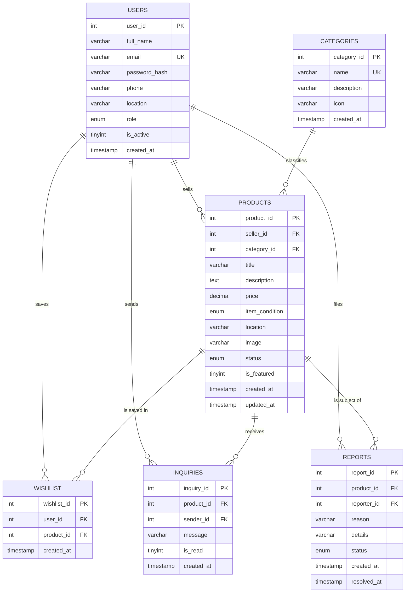

# ReMarket: Second-Hand Marketplace

A complete, working second-hand marketplace for a 3rd-year college microproject that combines **RDBMS** (MySQL) and **UID** (user interface design). Buyers and sellers in Kerala can list, search, save and enquire about used items; an admin panel handles users, products, categories and reports.

---

## 1. Project objective

1. Design a **normalised relational database** (6 tables, keys, constraints) for an online marketplace.
2. Build a **Flask web application** that performs full CRUD on that database using **parameterised SQL**.
3. Present the data through a **responsive, accessible interface** that follows UID principles.
4. Demonstrate SQL concepts (joins, aggregates, grouping, subqueries) with queries that answer real questions.

## 2. Features

**Users**
- Register, log in, log out (Werkzeug password hashing, Flask sessions)
- Browse, search (keyword), filter (category, price range, condition, location) and sort (newest, oldest, price)
- Product details with seller information; seller phone is visible to logged-in users only
- Add or remove products from a wishlist (updates without reloading)
- Send inquiries to sellers; sellers get an inbox with read/unread state
- Create, edit and delete **their own** listings, with photo upload and live preview
- Mark an item as sold, or relist it
- Profile page with account statistics, profile editing and password change
- Report a suspicious listing

**Admin**
- Dashboard: totals, listings per category, price statistics, active sellers, recent listings, pending reports
- Users: search, disable or enable, delete
- Products: filter, feature, remove (soft), restore, delete permanently
- Categories: add, edit, delete (blocked while listings use it)
- Reports: resolve, dismiss, or remove the reported listing in one click
- **SQL demo page** that runs 18 named queries and shows the SQL, the concepts and the result

## 3. Technology stack

| Layer | Technology |
|---|---|
| Frontend | HTML5, CSS3, JavaScript (vanilla), Bootstrap 5.3, Bootstrap Icons |
| Backend | Python 3.9+ with Flask |
| Database | MySQL 8 (MariaDB 10.5+ also works) |
| Driver | `mysql-connector-python` |
| Security | Werkzeug password hashing, Flask sessions, CSRF tokens, parameterised SQL |

No React or other heavy framework is used. Bootstrap, icons and fonts load from a CDN, so the first run needs an internet connection.

## 4. Folder structure

```text
second_hand_marketplace/
├── app.py                 # Flask routes, validation, authorisation
├── database.py            # MySQL helper functions (parameterised queries only)
├── demo_queries.py        # 18 example SQL queries shown on the Admin > SQL demo page
├── schema.sql             # Tables, constraints and sample data
├── requirements.txt
├── README.md
├── static/
│   ├── css/style.css
│   ├── js/script.js
│   ├── images/            # category placeholder pictures (SVG)
│   └── uploads/           # seller photos are saved here
└── templates/
    ├── base.html          # navbar, flash messages, footer, delete-confirm modal
    ├── _macros.html       # product card, form error and status badge macros
    ├── index.html  login.html  register.html  products.html  product_details.html
    ├── sell.html  my_listings.html  wishlist.html  profile.html  error.html
    └── admin/
        ├── layout.html  dashboard.html  users.html  products.html
        └── categories.html  reports.html  sql_demo.html
```

## 5. Database structure

Database name: `second_hand_marketplace`

| Table | Purpose | Key columns and constraints |
|---|---|---|
| `users` | Accounts for buyers, sellers and admins | PK `user_id`; `email` UNIQUE NOT NULL; `password_hash` NOT NULL; `role` ENUM DEFAULT 'user'; `is_active` DEFAULT 1; CHECK on phone length, e-mail pattern |
| `categories` | Product categories | PK `category_id`; `name` UNIQUE NOT NULL; `icon` DEFAULT 'bi-grid' |
| `products` | Items for sale | PK `product_id`; FK `seller_id` → users (CASCADE); FK `category_id` → categories (RESTRICT); CHECK `price > 0`; `item_condition` ENUM; `status` ENUM DEFAULT 'active'; `created_at`, `updated_at` timestamps |
| `wishlist` | Users' saved products | PK `wishlist_id`; FKs to users and products (CASCADE); **UNIQUE (user_id, product_id)** |
| `inquiries` | Buyer messages to sellers | PK `inquiry_id`; FKs to products and users (CASCADE); CHECK message length ≥ 10; `is_read` DEFAULT 0 |
| `reports` | Complaints about listings | PK `report_id`; FKs to products and users (CASCADE); `status` ENUM DEFAULT 'pending'; `resolved_at` NULL until closed |

Why it is normalised (3NF): every table stores facts about one thing only. A product stores the *id* of its seller and category, never their names. The seller of an inquiry is found through `products.seller_id`, so it is not stored twice. The many-to-many link between users and products lives in its own `wishlist` table.

## 6. ER diagram



### Relationships explained

- **Users → Products (one-to-many).** One user can sell many products; each product has exactly one seller (`products.seller_id`). Deleting a user deletes their products (`ON DELETE CASCADE`).
- **Categories → Products (one-to-many).** A category groups many products. `ON DELETE RESTRICT` stops an admin from deleting a category that still has listings.
- **Users ↔ Products through Wishlist (many-to-many).** A user can save many products and a product can be saved by many users. The `wishlist` table resolves this, and its UNIQUE pair prevents saving the same item twice.
- **Users and Products through Inquiries.** A buyer (`sender_id`) writes a message about a product. The receiving seller is `products.seller_id`, found with a JOIN.
- **Users and Products through Reports.** A user (`reporter_id`) complains about a product. An admin changes the report status to resolved or dismissed.

## 7. Installation and setup

### Prerequisites
- Python 3.9 or newer
- MySQL Server 8.x (or MariaDB 10.5+)
- An internet connection (for Bootstrap, icons and Google Fonts)

### Step 1: get the project and create a virtual environment
```bash
cd second_hand_marketplace
python -m venv venv

# Windows
venv\Scripts\activate
# macOS / Linux
source venv/bin/activate

pip install -r requirements.txt
```

### Step 2: create the database (MySQL setup)
Make sure the MySQL service is running, then load the schema and the sample data:
```bash
mysql -u root -p < schema.sql
```
Or open MySQL Workbench, open `schema.sql` and run the whole script. It creates the `second_hand_marketplace` database, all six tables and the sample data. **Running it again resets the database.**

Check that it worked:
```sql
USE second_hand_marketplace;
SELECT COUNT(*) FROM products;   -- 22
```

### Step 3: tell Flask your MySQL password
`database.py` reads these environment variables (defaults in brackets): `DB_HOST` (localhost), `DB_PORT` (3306), `DB_USER` (root), `DB_PASSWORD` (empty), `DB_NAME` (second_hand_marketplace).

```bash
# Windows PowerShell
$env:DB_PASSWORD="your_mysql_password"
# Windows cmd
set DB_PASSWORD=your_mysql_password
# macOS / Linux
export DB_PASSWORD="your_mysql_password"
```

### Step 4: run Flask
```bash
python app.py
```
Open **http://127.0.0.1:5000** in your browser.

## 8. Demo credentials

| Role | Email | Password |
|---|---|---|
| Admin | `admin@remarket.in` | `Admin@123` |
| Seller (Kochi) | `anu@example.com` | `User@123` |
| Seller (Kottayam) | `rahul@example.com` | `User@123` |
| Seller (Kozhikode) | `fathima@example.com` | `User@123` |
| Seller (Pathanamthitta) | `joseph@example.com` | `User@123` |
| Seller (Thiruvananthapuram) | `sneha@example.com` | `User@123` |
| Buyer only (no listings) | `divya@example.com` | `User@123` |

Other users: `arjun@`, `meera@`, `vishnu@`, `nisha@` (all `@example.com`, password `User@123`). All people, phone numbers and listings are fictional.

**Suggested demo flow:** log in as `rahul@example.com` and open *My listings* to see inquiries on the Activa; log in as `admin@remarket.in` and open *Reports* and *SQL demo*.

## 9. RDBMS concepts demonstrated

| Concept | Where to see it |
|---|---|
| Primary keys, AUTO_INCREMENT | every table in `schema.sql` |
| Foreign keys with CASCADE / RESTRICT | `products`, `wishlist`, `inquiries`, `reports` |
| UNIQUE, NOT NULL, DEFAULT, CHECK, ENUM | `users.email`, `wishlist (user_id, product_id)`, `products.price > 0`, `status` defaults |
| Timestamps | `created_at`, `updated_at ON UPDATE CURRENT_TIMESTAMP`, `resolved_at` |
| Indexes | `idx_products_status_created`, `idx_products_category`, `idx_products_price` |
| **INSERT** | register, sell, wishlist toggle, inquiry, report, admin add category |
| **SELECT** | every page; see `demo_queries.py` |
| **UPDATE** | edit listing, mark sold, mark inquiry read, profile, admin actions, resolve report |
| **DELETE** | delete listing, remove from wishlist, delete user or category |
| WHERE, AND/OR | all filters in `/products` |
| LIKE | keyword search, location filter, admin user search |
| BETWEEN | price range filter |
| IN | condition checkboxes (`item_condition IN (...)`) |
| ORDER BY, LIMIT/OFFSET | sorting and pagination |
| GROUP BY, HAVING | category counts, active sellers (`HAVING COUNT(*) >= 2`) |
| COUNT, AVG, MIN, MAX, SUM | admin dashboard, profile statistics |
| INNER JOIN | product cards (products + categories + users) |
| LEFT JOIN | category counts including empty categories; unanswered listings |
| Subqueries | profile statistics, "priced above average" query |
| Transactions and integrity | cascading deletes keep child tables consistent |
| SQL injection protection | every query uses `%s` placeholders through `database.py` |

Open **Admin → SQL demo** to run 18 ready-made queries live.

## 10. UID principles applied

| Principle | How it is applied |
|---|---|
| **Consistency** | One accent colour (teal), one tag colour (amber), the same card, button and form styles on every page |
| **Visual hierarchy** | Large page titles, price on a high-contrast tag, muted secondary text, one primary button per area |
| **Familiar metaphor** | The price tag shape reminds users of second-hand shops and makes prices the first thing seen |
| **Feedback** | Success, error, warning and info messages; toasts for wishlist changes; inline field errors |
| **Error prevention** | Client-side validation plus server-side validation; confirmation modal before any delete |
| **Accessibility** | Labels on every field, alt text on images, skip link, visible focus rings, ARIA labels and live regions, colour contrast checked, reduced-motion support |
| **Responsiveness** | Bootstrap grid; filters collapse on mobile; tables scroll horizontally; admin sidebar becomes a top strip |
| **Simplicity and spacing** | Generous white space, short plain-language labels, empty states that tell users what to do next |
| **Motion with purpose** | Featured items hang in once on the home page; hearts pop when toggled; cards lift on hover |

## 11. Security measures

- Passwords stored with `generate_password_hash` and checked with `check_password_hash`
- Flask signed sessions (HttpOnly, SameSite=Lax cookies); `login_required` and `admin_required` decorators
- CSRF token on every POST form and AJAX request
- Parameterised SQL everywhere; LIKE wildcards typed by users are escaped
- Server-side validation of every field, including file type and file signature of uploaded photos
- Ownership checks: editing, deleting or relisting a product requires `seller_id == logged-in user` (otherwise HTTP 403); the SQL `WHERE` also includes `seller_id`
- Jinja auto-escaping prevents stored XSS; redirects after login accept local paths only
- Disabled users are logged out on their next request

## 12. Viva questions and answers

1. **Why did you choose MySQL?** It is a relational database that enforces keys and constraints, supports joins and aggregates, and is free and widely used.
2. **What is a primary key? Name one.** A column that uniquely identifies each row and cannot be NULL, for example `products.product_id`.
3. **What is a foreign key?** A column that refers to the primary key of another table, such as `products.seller_id` → `users.user_id`. It guarantees that a product cannot point to a user who does not exist.
4. **What is the difference between ON DELETE CASCADE and RESTRICT?** CASCADE deletes the child rows automatically (deleting a user deletes their products). RESTRICT blocks the delete while child rows exist (a category with products cannot be deleted).
5. **Which relationship needs a separate table, and why?** Many-to-many. Users and products are linked through `wishlist` because one user can save many products and one product can be saved by many users.
6. **How did you normalise the database?** Each table stores one entity. There are no repeating groups (1NF), no partial dependencies (2NF) and no transitive dependencies (3NF); for example the product stores `category_id`, not the category name.
7. **Which constraints did you use?** PRIMARY KEY, FOREIGN KEY, UNIQUE (email, wishlist pair), NOT NULL, DEFAULT (status, role), CHECK (price > 0, phone length, message length) and ENUM.
8. **Difference between WHERE and HAVING?** WHERE filters rows before grouping; HAVING filters groups after aggregation. The active sellers query uses `HAVING COUNT(*) >= 2`.
9. **INNER JOIN versus LEFT JOIN?** INNER JOIN returns only matching rows. LEFT JOIN keeps every row of the left table, so categories with zero products still appear with a count of 0.
10. **How do you find products nobody has asked about?** `LEFT JOIN inquiries ... WHERE inquiry_id IS NULL`.
11. **How is SQL injection prevented?** User input is never concatenated into SQL. It is sent as parameters (`%s`), so the database treats it as data, not code.
12. **How are passwords protected?** They are hashed with a salted algorithm (scrypt via Werkzeug). The plain password is never stored.
13. **How do you stop one user editing another user's listing?** The route compares `seller_id` with the logged-in user and returns 403 if they differ, and the UPDATE or DELETE statement also filters on `seller_id`.
14. **What is a session?** Server-signed data stored in a browser cookie that remembers the logged-in user between requests.
15. **What is CSRF and how did you stop it?** A malicious site tricking your browser into submitting a request. Every POST must carry a secret token that matches the one in the user's session.
16. **Why use an index?** It speeds up searches on columns used in WHERE and ORDER BY, such as `status`, `category_id` and `price`, at the cost of slightly slower writes.
17. **Why a soft delete (status = 'removed') for admin removal?** It keeps the record for audit and allows restoring it, while hiding it from the public.
18. **Which UID principle matters most here?** Consistency and hierarchy: one colour system and the price tag make the interface predictable and scannable.
19. **How is the layout responsive?** Bootstrap's 12-column grid with breakpoints, flexible images, collapsing filters and scrollable tables.
20. **How would you scale this?** Add connection pooling, move images to cloud storage, add full-text search indexes and caching, and run Flask behind Gunicorn and Nginx.

## 13. Troubleshooting

| Problem | Fix |
|---|---|
| `Access denied for user 'root'` | Set `DB_PASSWORD` correctly (Step 3) |
| `Can't connect to MySQL server` | Start the MySQL service |
| `Unknown database 'second_hand_marketplace'` | Run `mysql -u root -p < schema.sql` |
| Page looks unstyled | Bootstrap loads from a CDN; check your internet connection |
| CHECK constraints ignored | Use MySQL 8.0.16+ or MariaDB 10.2+ |
| "Request could not be verified" | Your session expired; refresh the page and try again |

## 14. Future enhancements

- Real-time chat between buyer and seller (WebSockets)
- Multiple photos per listing and image compression
- Email or SMS verification and password reset by email
- Ratings and reviews for sellers
- Map-based "near me" search using coordinates
- Saved searches and price-drop alerts for wishlist items
- Online payment or escrow for safer transactions
- Admin analytics charts and CSV export
- Full-text search and recommendation of similar items
- Docker setup and deployment with Gunicorn and Nginx
